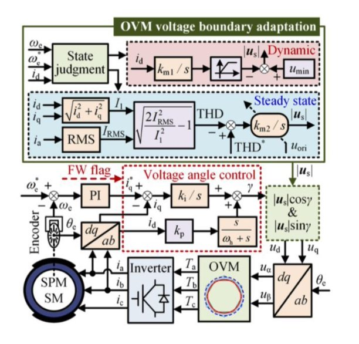
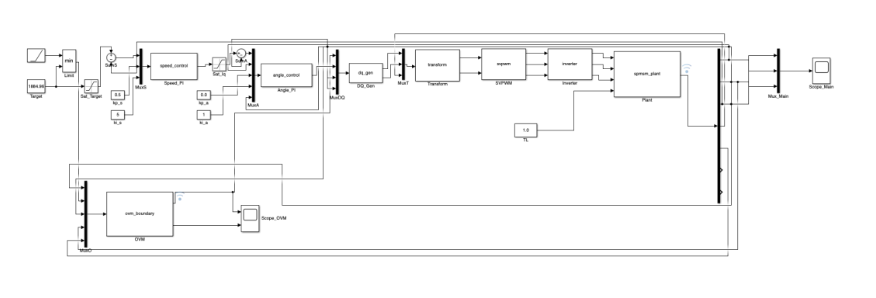
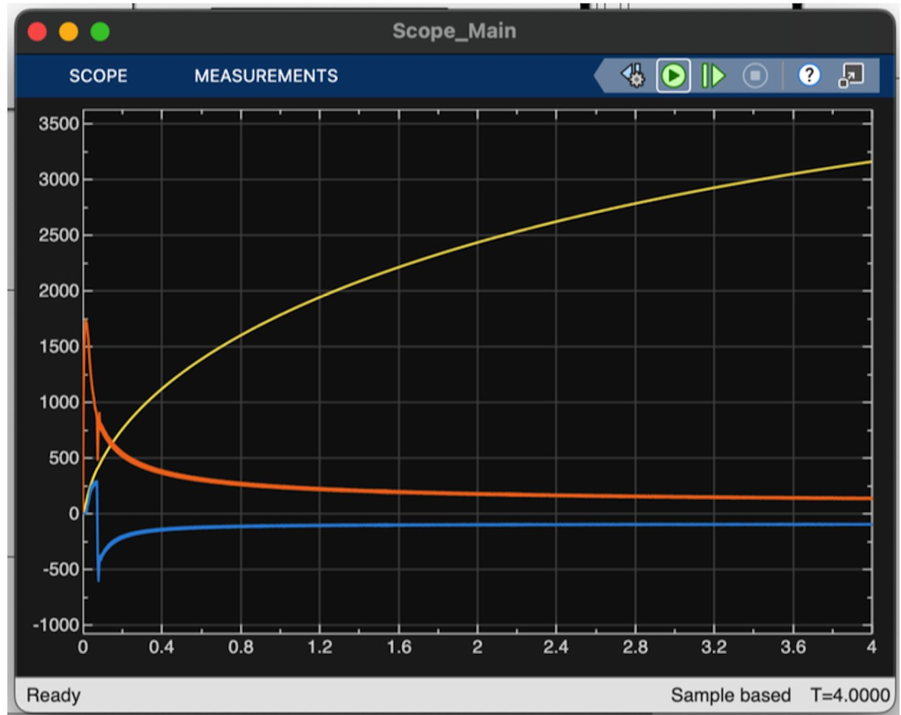
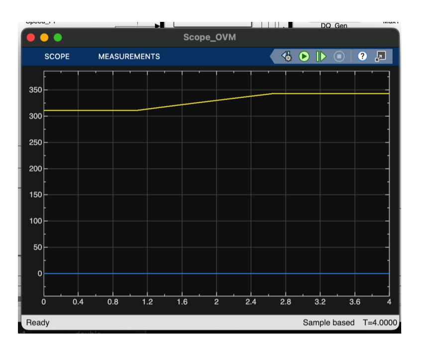
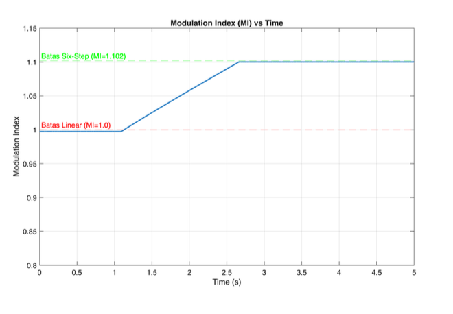
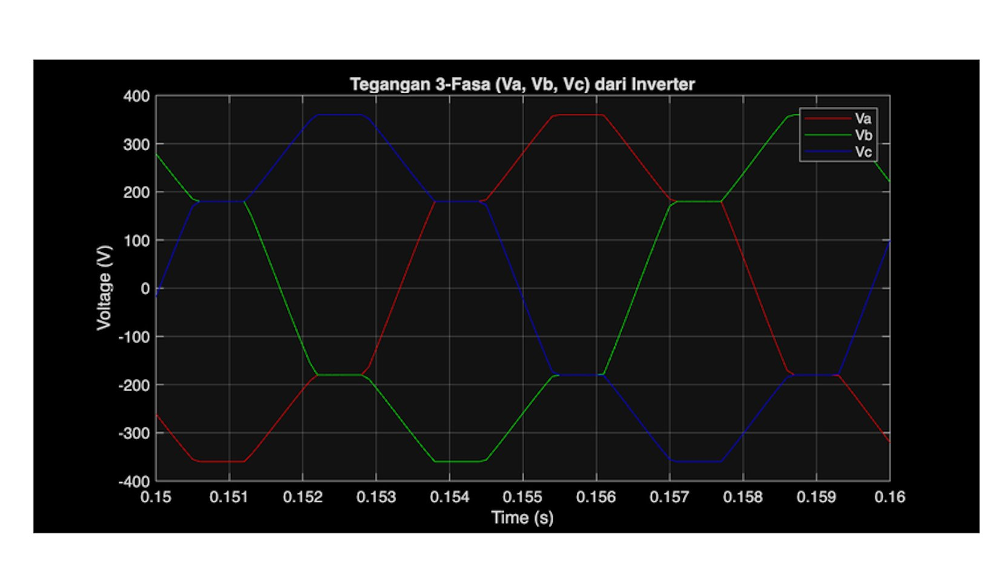

# Overmodulation Voltage Boundary Adaptation-Based Field Weakening Strategy for High-Speed SPMSM Drives

[](https://www.mathworks.com/products/simulink.html)
[](https://www.mathworks.com/help/simulink/sfg/c-mex-s-functions.html)
[](#control-architecture--methodology)
[](https://ee.ui.ac.id/)

This repository hosts the MATLAB/Simulink and C-MEX S-Function implementation of an **Overmodulation (OVM) Voltage Boundary Adaptation-Based Field Weakening Strategy** for high-speed Surface-Mounted Permanent Magnet Synchronous Motor (**SPMSM**) drives. 

Based on the research paper by *Jing et al.* and developed for the *Sistem Kendali Motor Listrik (Electric Motor Control Systems)* course at **Universitas Indonesia (Departemen Teknik Elektro)**, this project demonstrates how adaptive overmodulation expands the available DC-link voltage headroom and maximum speed/torque envelope during dynamic acceleration while regulating stator current Total Harmonic Distortion (**THD**) during steady-state operation.

---

## Table of Contents
1. [Project Overview & Motivation](#project-overview--motivation)
2. [Control Architecture & Methodology](#control-architecture--methodology)
   - [Dynamic State: Voltage Boundary Acceleration](#1-dynamic-state-voltage-boundary-acceleration)
   - [Steady State: THD-Based Boundary Regulation](#2-steady-state-thd-based-boundary-regulation)
   - [Voltage Angle Control & DQ Generation](#3-voltage-angle-control--dq-generation)
   - [Space Vector Overmodulation (OVM) Regions](#4-space-vector-overmodulation-ovm-regions)
3. [Simulink Model Architecture & C-MEX Implementation](#simulink-model-architecture--c-mex-implementation)
   - [Model Diagram](#model-diagram)
   - [Continuous SPMSM Plant S-Function (`plant_motor.c`)](#continuous-spmsm-plant-s-function-plant_motorc)
   - [Discrete PI & Anti-Windup Controller (`pid_control.c`)](#discrete-pi--anti-windup-controller-pid_controlc)
4. [Motor & System Parameters](#motor--system-parameters)
5. [Simulation Results & Waveform Analysis](#simulation-results--waveform-analysis)
   - [1. Dynamic Current & High-Speed Trajectory](#1-dynamic-current--high-speed-trajectory)
   - [2. OVM Voltage Boundary Adaptation Profile](#2-ovm-voltage-boundary-adaptation-profile)
   - [3. Modulation Index (MI) Transition](#3-modulation-index-mi-transition)
   - [4. Three-Phase Inverter Output Voltages](#4-three-phase-inverter-output-voltages)
6. [Model Evaluation & Identified Challenges](#model-evaluation--identified-challenges)
7. [Getting Started & Reproduction Guide](#getting-started--reproduction-guide)
8. [Repository Structure](#repository-structure)
9. [References & Acknowledgements](#references--acknowledgements)

---

## Project Overview & Motivation

Surface-Mounted Permanent Magnet Synchronous Motors (**SPMSM**) are widely utilized in electric vehicles (EV), aerospace actuators, and ultra-high-speed industrial drives due to their superior torque density, fast dynamic response, and high operational efficiency. 

### The High-Speed Bottleneck
1. **Back-EMF Saturation**: As rotor mechanical speed $\omega_m$ increases above the rated base speed, motor back-electromotive force (Back-EMF) scales linearly ($e \propto \psi_f \omega_e$). When back-EMF approaches the inverter voltage limit, the inverter loses current controllability unless flux-weakening is employed.
2. **Current Limits in Standard FW**: In SPMSM, reluctance torque is absent ($L_d = L_q = L_s$). Field weakening requires injecting a large negative demagnetizing d-axis current ($i_d < 0$) to depress total armature flux ($\psi_d = L_s i_d + \psi_f$). Because total current is bounded by the inverter current rating ($\sqrt{i_d^2 + i_q^2} \le I_{\max}$), an aggressive negative $i_d$ significantly diminishes available q-axis torque current $i_q$.
3. **Linear Modulation Inverter Ceiling**: In conventional Space Vector PWM (SVPWM), the maximum linear output phase voltage fundamental peak is bounded by:
   $$u_{\max,\text{linear}} = \frac{V_{dc}}{\sqrt{3}}$$
   For a $V_{dc} = 540\text{ V}$ bus, the linear boundary is strictly capped at $\approx 311.77\text{ V}$.

### The Adaptive Overmodulation Solution
Overmodulation (OVM) pushes the inverter voltage vector into the non-linear modulation region, allowing fundamental voltage utilization to scale all the way to the **six-step limit**:
$$u_{\max,\text{six-step}} = \frac{2}{\pi} V_{dc} \approx 343.8\text{ V} \quad (\approx 10.27\% \text{ additional voltage headroom})$$

However, standard uncontrolled OVM causes substantial low-order harmonic currents (5th, 7th, 11th, etc.) and elevated THD. This project implements an **adaptive boundary scheme**:
* **Dynamic Mode**: Maximizes voltage boundary ($u_s \to 343\text{ V}$) for maximum acceleration rate.
* **Steady-State Mode**: Automatically rolls back voltage boundary $u_s$ to satisfy a designated current THD target ($\approx 5\%$).

---

## Control Architecture & Methodology

The complete control scheme combines **Voltage Boundary Adaptation**, **Voltage Angle Control**, and **Space Vector Overmodulation (OVM)**:



### 1. Dynamic State: Voltage Boundary Acceleration
The system enters **Dynamic State** when the speed tracking error exceeds the switching threshold:
$$|\omega_e^* - \omega_e| > 10\text{ rad/s}$$

* **Objective**: Rapid acceleration and maximum field weakening depth.
* **Action**: Integrates demagnetizing current $i_d$ through gain $k_{m1}/s$, passing through a saturation limiter to expand the voltage boundary $|u_s|$ above nominal:
  $$|u_s| = u_{\min} + \Delta u_{s,\text{dyn}}(i_d)$$
  where $u_{\min} \approx 311\text{ V}$ and $|u_s|$ can dynamically increase up to $\approx 343\text{ V}$.

### 2. Steady State: THD-Based Boundary Regulation
The system enters **Steady State** when speed error settles:
$$|\omega_e^* - \omega_e| \le 10\text{ rad/s}$$

* **Objective**: Maintain optimal power quality, suppress low-order stator harmonics, and mitigate motor acoustic noise.
* **Fundamental Current Calculation**:
  $$I_1 = \sqrt{i_d^2 + i_q^2}$$
* **Stator Current THD Formulation**:
  $$THD(i_a) = \frac{\sqrt{2 I_{\text{RMS}}^2 - I_1^2}}{I_1} = \frac{\sqrt{2} I_{\text{OVM}}}{I_1} \times 100\%$$
* **Boundary Closed-Loop**:
  $$e_{\text{THD}} = THD^* - THD(i_a)$$
  The error drives integrator $k_{m2}/s$ to modulate the voltage amplitude $|u_s|$ around an equilibrium point that precisely satisfies $THD^* \approx 5\%$.

### 3. Voltage Angle Control & DQ Generation
Rather than utilizing traditional coupled d-q PI current regulators which easily saturate in overmodulation, **Voltage Angle Control** directly commands the stator voltage vector magnitude $|u_s|$ and phase angle $\gamma$:

$$\gamma = \int k_i (i_q^* - i_q)\, dt + \left( \frac{s}{\omega_h + s} \right) k_p \cdot i_d$$

The d-q voltage references are synthesized directly as:
$$u_d = |u_s| \cos\gamma, \qquad u_q = |u_s| \sin\gamma$$

These references undergo inverse Park transformation ($\theta_e$) to obtain stationary frame voltages $(u_\alpha, u_\beta)$, which are fed to the OVM modulation engine.

### 4. Space Vector Overmodulation (OVM) Regions
The modulation index is defined as:
$$MI = \frac{|u_s|}{V_{dc}/\sqrt{3}}$$

| Region | Modulation Index ($MI$) | Trajectory | Characteristics |
|---|---|---|---|
| **Linear SVPWM** | $0 \le MI \le 1.0$ | Circular boundary | Pure sinusoidal fundamental, zero low-order harmonics |
| **OVM Region I** | $1.0 < MI \le 1.05$ | Circle partially truncated by hexagon edges | Holding angle $\alpha_h = 0$, vector amplitude nonlinearly scaled |
| **OVM Region II** | $1.05 < MI \le 1.102$ | Vector held at hexagon corners for duration $\alpha_h$ | Holding angle $\alpha_h > 0$, transition towards six-step |
| **Six-Step Mode** | $MI = 2/\sqrt{3} \cdot (2/\pi) \approx 1.1026$ | Discrete hexagon switching | Max voltage capability ($2V_{dc}/\pi$), richest harmonic spectrum |

---

## Simulink Model Architecture & C-MEX Implementation

### Model Diagram
The complete control drive is implemented in Simulink using a modular subsystem architecture:



The primary signal flow consists of:
1. `Speed_PI` (`speed_control`): Outer velocity regulation generating reference torque current $i_q^*$.
2. `Angle_PI` (`angle_control`): Voltage angle loop synthesizing vector angle $\gamma$.
3. `DQ_Gen`: Evaluates $u_d = |u_s|\cos\gamma$ and $u_q = |u_s|\sin\gamma$.
4. `Transform`: Converts $(u_d, u_q) \to (u_\alpha, u_\beta)$ via inverse Park transform.
5. `SVPWM` / `OVM`: Space vector overmodulation block generating three-phase duty cycles $(T_a, T_b, T_c)$.
6. `Inverter`: Voltage-source inverter generating three-phase terminal voltages $(V_a, V_b, V_c)$.
7. `spmsm_plant`: Continuous state-space C-MEX S-Function modeling motor physics.
8. `ovm_boundary`: Adaptation block receiving $\omega_e, \omega_e^*, i_d, i_q, i_a$ to compute dynamic $|u_s|$.

---

### Continuous SPMSM Plant S-Function (`plant_motor.c`)
To ensure high simulation fidelity and numerical stability at ultra-high rotational frequencies, the SPMSM motor dynamics are implemented in a Level-2 continuous C-MEX S-Function.

The non-linear state-space continuous equations solved in `mdlDerivatives`:

$$\frac{d i_d}{dt} = -\frac{R_s}{L_s} i_d + P \omega_m i_q + \frac{1}{L_s} u_d$$

$$\frac{d i_q}{dt} = -P \omega_m i_d - \frac{R_s}{L_s} i_q - \frac{P \psi_f}{L_s} \omega_m + \frac{1}{L_s} u_q$$

$$\frac{d \omega_m}{dt} = \frac{3 P \psi_f}{2 J} i_q - \frac{B}{J} \omega_m - \frac{1}{J} T_L$$

```c
// Core derivative computation in plant_motor.c
real_T id = X[0];
real_T iq = X[1];
real_T wm = X[2];

real_T ud = U(0);
real_T uq = U(1);
real_T TL = U(2);

// Non-linear State Space Equations:
dX[0] = -(Rs/Ls)*id + P*wm*iq + (1.0/Ls)*ud;      
dX[1] = -P*wm*id - (Rs/Ls)*iq - (P*Phif/Ls)*wm + (1.0/Ls)*uq; 
dX[2] = (3.0*P*Phif/(2.0*J))*iq - (B/J)*wm - (1.0/J)*TL;
```

---

### Discrete PI & Anti-Windup Controller (`pid_control.c`)
The cascaded current and velocity regulators feature discrete Level-2 C-MEX implementation with **conditional integration anti-windup clamping**:

```c
// Anti-windup conditional integration in pid_control.c
real_T iq_ref_temp = (Kp_w * error_w) + (Ki_w * X[INT_ERR_W_IDX]);

// Only integrate if within saturation boundaries or error tends to unwind
if ((iq_ref_temp < MAX_IQ_REF && iq_ref_temp > -MAX_IQ_REF) || 
    (iq_ref_temp >= MAX_IQ_REF && error_w < 0) || 
    (iq_ref_temp <= -MAX_IQ_REF && error_w > 0)) {
    X[INT_ERR_W_IDX] += error_w * dt;
}
```

---

## Motor & System Parameters

The simulation parameters represent a high-power, high-speed SPMSM drive system:

| Parameter | Symbol | Nominal Value | Unit |
|---|---|---|---|
| **Stator Resistance** | $R_s$ | `0.17` | $\Omega$ |
| **Stator Inductance** | $L_s$ ($L_d = L_q$) | `0.75` | $\text{mH}$ ($7.5 \times 10^{-4}\text{ H}$) |
| **Permanent Magnet Flux Linkage** | $\psi_f$ | `0.073` | $\text{Wb}$ |
| **Pole Pairs** | $P$ | `2` | — |
| **Mechanical Rotor Inertia** | $J$ | `0.1` | $\text{kg}\cdot\text{m}^2$ |
| **Inverter DC-Link Voltage** | $V_{dc}$ | `540.0` | $\text{V}$ |
| **Nominal Linear Voltage Limit** | $u_{\min} = V_{dc}/\sqrt{3}$ | `311.77` | $\text{V}_{\text{peak}}$ |
| **Maximum Six-Step Voltage Limit** | $u_{\max} = 2V_{dc}/\pi$ | `343.77` | $\text{V}_{\text{peak}}$ |
| **Target Mechanical Speed** | $\omega_m^*$ | `942.0` | $\text{rad/s}$ ($\approx 9000\text{ RPM}$) |
| **Target Electrical Speed** | $\omega_e^* = P \omega_m^*$ | `1884.96` | $\text{rad/s}$ |
| **External Load Torque** | $T_L$ | `1.0` | $\text{N}\cdot\text{m}$ |
| **Current Loop Sample Time** | $T_{s,\text{ctrl}}$ | `100` | $\mu\text{s}$ ($1.0 \times 10^{-4}\text{ s}$) |

---

## Simulation Results & Waveform Analysis

### 1. Dynamic Current & High-Speed Trajectory
Below is the transient response captured on `Scope_Main` during full acceleration up to the target speed:



* **Mechanical Speed $\omega_m$ (Yellow trace)**: Smoothly accelerates from standstill, exceeding base speed and continuing past $3000\text{ rad/s}$ into deep field-weakening without loss of synchronism.
* **Torque Current $i_q$ (Orange trace)**: Surges to the maximum current limit during initial acceleration to provide peak torque. As back-EMF approaches DC bus limits, $i_q$ smoothly decays, signaling entry into the constant-power region.
* **Flux Weakening Current $i_d$ (Blue trace)**: Remains near zero at low speeds ($i_d = 0$ control), then transitions sharply negative (reaching down past $-500\text{ A}$ dynamically before settling near $-100\text{ A}$ to $-150\text{ A}$) to demagnetize the d-axis and constrain terminal voltage.

---

### 2. OVM Voltage Boundary Adaptation Profile
The dynamic voltage boundary adaptation output captured from `Scope_OVM`:



* **Nominal Boundary ($t < 1.1\text{ s}$)**: In the initial speed range, the boundary is held firmly at nominal linear limit $|u_s| = 311\text{ V}$.
* **Adaptive Ramp ($1.1\text{ s} \le t \le 2.6\text{ s}$)**: As the motor enters deep field weakening and speed tracking demands maximum acceleration, the adaptation algorithm ramps $|u_s|$ continuously up to $\approx 343\text{ V}$.
* **Saturation Plateau ($t > 2.6\text{ s}$)**: The voltage boundary reaches the theoretical physical limit of the inverter in six-step mode ($\approx 343.8\text{ V}$), providing the maximum possible voltage headroom to sustain acceleration.

---

### 3. Modulation Index (MI) Transition
The modulation index tracking across operating regimes:



* **Linear Region ($MI = 1.0$)**: The inverter operates under standard linear SVPWM without waveform distortion.
* **Overmodulation Ramp**: $MI$ transitions smoothly from $1.0$ through OVM Region I and Region II.
* **Six-Step Boundary ($MI = 1.102$)**: At high velocity, $MI$ locks precisely onto the six-step boundary ($MI \approx 1.102$), maximizing DC-bus utilization.

---

### 4. Three-Phase Inverter Output Voltages
The line and phase voltages delivered by the inverter during overmodulation:



* **Phase Balance**: Voltages $V_a, V_b, V_c$ maintain balanced $120^\circ$ phase displacements.
* **Flat-Topping Distortion**: The transition into OVM causes characteristic trapezoidal flat-topping around $\pm 360\text{ V}$, reflecting the non-linear pulse-width holding behavior of overmodulation.
* **Voltage Headroom**: The fundamental harmonic amplitude is increased by $\approx 10\%$, enabling sustained motor torque at speeds where conventional linear SVPWM would stall.

---

## Model Evaluation & Identified Challenges

As documented in the analytical review (`main-8.pdf`, Slide 13), several numerical and structural aspects were evaluated for future optimization:

1. **Algebraic Loops in Feedback Path**:
   * *Issue*: High-gain direct feedthrough in the current-to-voltage-angle loop and speed feedback can cause Simulink's solver to detect an algebraic loop, requiring iterative solver sub-steps.
   * *Mitigation*: Introduce single-sample unit delays ($z^{-1}$) or explicit state buffers between controller output and plant input.
2. **Multi-Rate Sample Time Synchronization**:
   * *Issue*: The SPMSM plant operates in continuous time (`CONTINUOUS_SAMPLE_TIME`), whereas the OVM boundary and discrete PID functions execute at discrete sample rates ($100\ \mu\text{s}$). Discretization errors can emerge at extreme stator frequencies ($> 1\text{ kHz}$ fundamental).
   * *Mitigation*: Ensure explicit Zero-Order Hold (ZOH) blocks are inserted at domain boundaries.
3. **Parameter Configuration in C-MEX**:
   * *Issue*: Motor physical parameters ($R_s, L_s, \psi_f, J$) are currently hardcoded or parameterized across separate C source files and script variables.
   * *Mitigation*: Migrate parameters into Simulink Mask Dialog parameters passed directly into `ssGetSFcnParam(S, IDX)`.
4. **Quantitative Benchmark Validation**:
   * *Recommendation*: Implement side-by-side automated test harness comparing this adaptive OVM strategy against standard fixed-boundary FOC ($MI \le 1.0$) to directly quantify torque envelope expansion and THD penalty metrics.

---

## Getting Started & Reproduction Guide

### Prerequisites
* **MATLAB & Simulink**: Version R2022b, R2023a/b, or R2024a.
* **C Compiler**: Supported MEX C compiler configured (Xcode on macOS, GCC on Linux, or MinGW-w64 / Microsoft Visual C++ on Windows).
  Verify setup in MATLAB command window:
  ```matlab
  mex -setup C
  ```

### Step-by-Step Execution

1. **Clone the Repository**:
   ```bash
   git clone https://github.com/your-username/spmsm-ovm-field-weakening.git
   cd spmsm-ovm-field-weakening
   ```

2. **Compile C-MEX S-Functions**:
   Open MATLAB in this directory and compile the C source files:
   ```matlab
   mex plant_motor.c
   mex pid_control.c
   ```
   *This generates `plant_motor.mex*` and `pid_control.mex*` binaries for your platform.*

3. **Initialize System Parameters**:
   Execute the setup script to load motor parameters, control gains, and reference values into the MATLAB Base Workspace:
   ```matlab
   init_pmsm_params
   ```

4. **Run Simulation**:
   Open the Simulink model and start the simulation:
   ```matlab
   open_system('diagram.slx');
   sim('diagram');
   ```

5. **View Results**:
   * Double-click `Scope_Main` to inspect motor mechanical speed $\omega_m$, torque current $i_q$, and demagnetizing current $i_d$.
   * Double-click `Scope_OVM` to view the adaptive voltage boundary $|u_s|$ progression.

---

## Repository Structure

```
├── README.md                      # Comprehensive project documentation
├── main-8.pdf                     # Academic presentation & IEEE paper simulation report
├── diagram.slx                    # Master MATLAB/Simulink simulation model
├── init_pmsm_params.m             # Parameter initialization and gain tuning script
├── plant_motor.c                  # Level-2 Continuous C-MEX S-Function for SPMSM plant
├── pid_control.c                  # Level-2 Discrete C-MEX S-Function for PID controllers
├── plant_motor.mexmaci64          # Compiled MEX binary for macOS ARM64 / Apple Silicon
├── pid_control.mexmaci64          # Compiled MEX binary for macOS ARM64 / Apple Silicon
├── assets/                        # Simulation result waveforms and block diagrams
│   ├── ovm_boundary_control_strategy.jpg
│   ├── simulink_overall_model.png
│   ├── scope_ovm_voltage_boundary.png
│   ├── modulation_index_vs_time.png
│   ├── inverter_3phase_voltage.jpg
│   └── scope_main_speed_currents.jpg
```

---

## References & Acknowledgements

* **Course**: *Sistem Kendali Motor Listrik* (Electric Motor Control Systems), Departemen Teknik Elektro, Fakultas Teknik, **Universitas Indonesia** (June 2026).
* **Author / Researcher**: **Fathih Rayyandra Firmansyah** (NPM: 2306205260).
* **Reference Literature**:
  * Jing et al., *"Overmodulation Voltage Boundary Adaptation-Based Field Weakening Strategy for High-Speed SPMSM Drives"*, IEEE Transactions on Power Electronics / Industry Applications.
  * J. Holtz, *"Methods for Space Vector Modulation into the Overmodulation Range"*, IEEE Trans. Ind. Appl.
  * B. K. Bose, *Modern Power Electronics and AC Drives*, Prentice Hall.

---

<p align="center">
  <b>Departemen Teknik Elektro — Fakultas Teknik Universitas Indonesia</b><br>
  <i>Electric Motor Drives & Power Electronics Laboratory</i>
</p>
